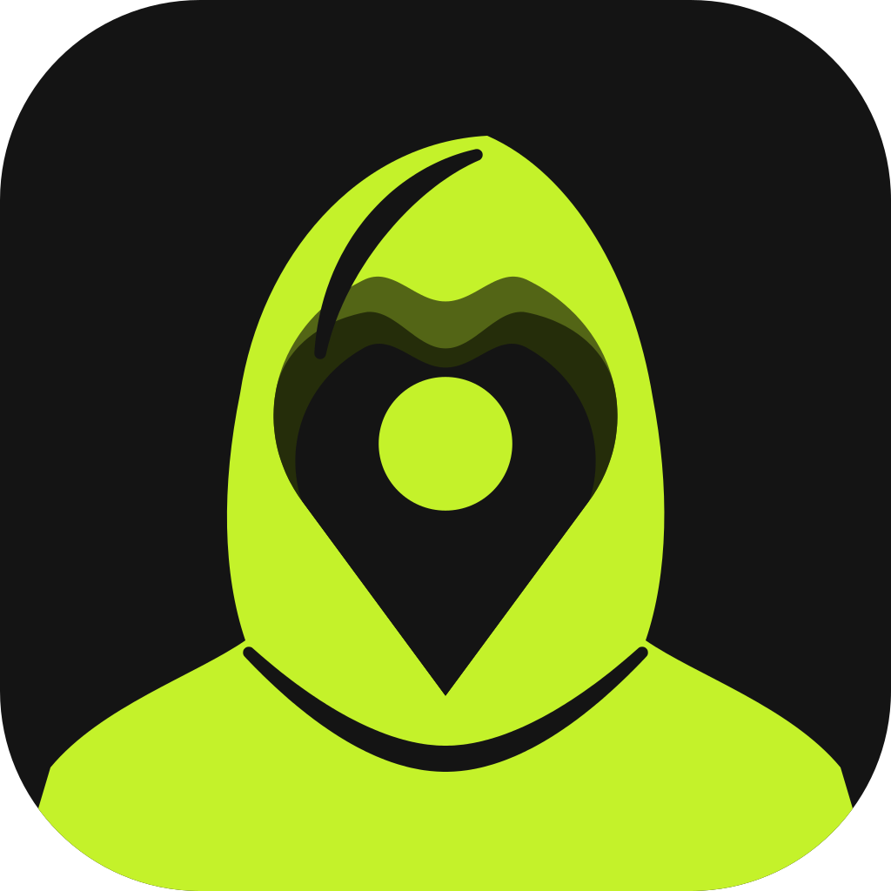
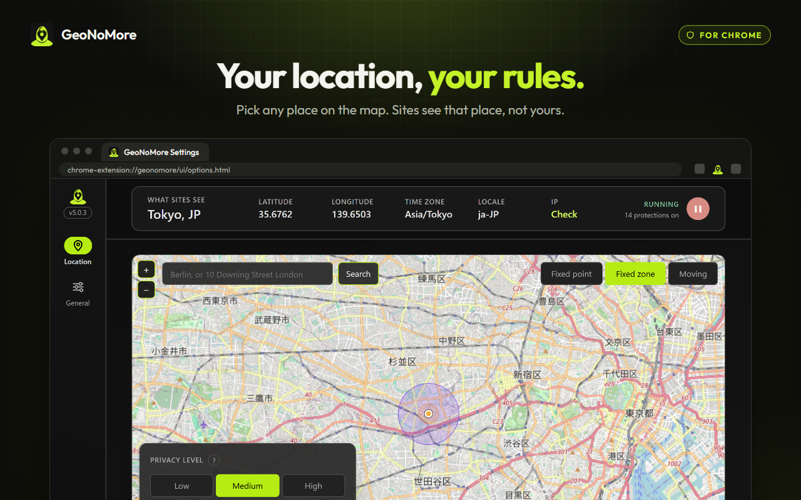
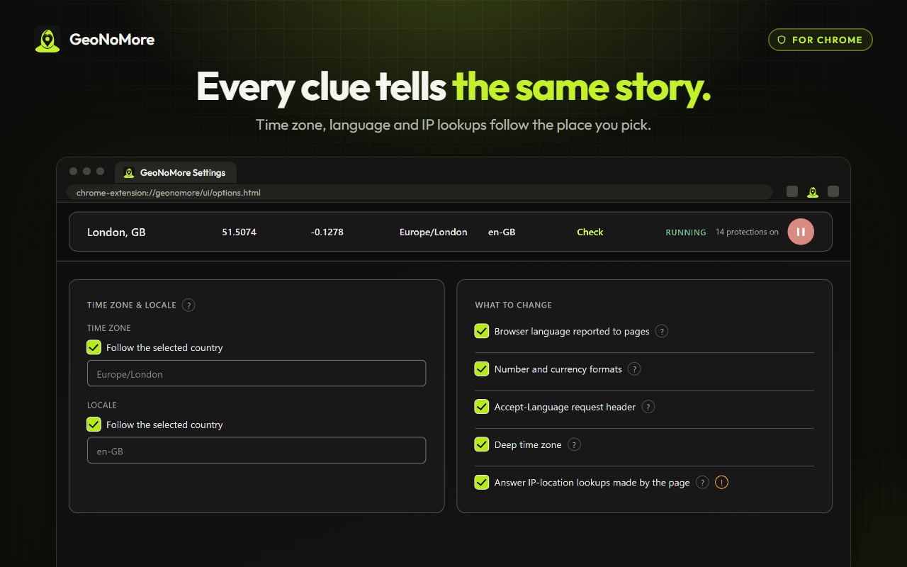
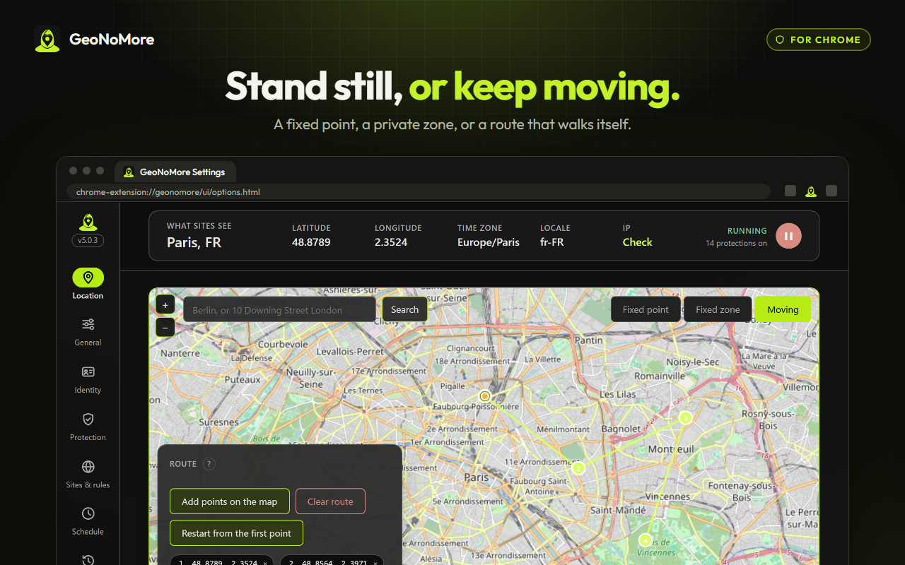
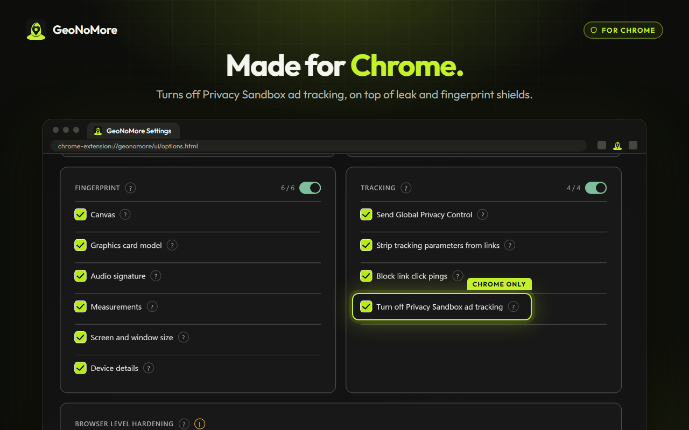
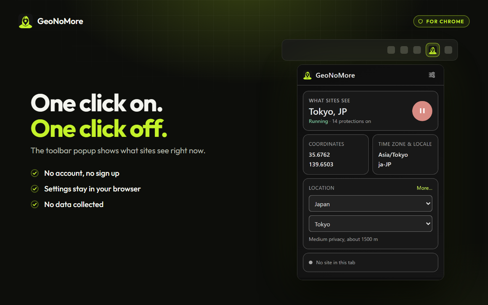

<div align="center">

<picture>
  <source media="(prefers-color-scheme: dark)" srcset="./assets/logo-dark.svg">
  
</picture>

# GeoNoMore

**Fake your GPS location in Chrome and Firefox, with the time zone and language kept in step so nothing gives you away.**

[](./LICENSE)
[](https://github.com/Miabeyefendi/GeoNoMore/releases/latest)
[](#)
[](#)
[](https://github.com/Miabeyefendi)

**English** · [Türkçe](./docs/locales/README_TR.md) · [Español](./docs/locales/README_ES.md) · [简体中文](./docs/locales/README_ZH.md) · [Русский](./docs/locales/README_RU.md)

[Install](#-installation) · [Features](#-highlights) · [Usage](#-quick-start) · [Changelog](./CHANGELOG.md)

<a href="https://github.com/Miabeyefendi/GeoNoMore/releases/latest">
  
</a>



</div>

---

## ✨ Highlights

- **Fake GPS location** - every site that asks where you are gets the place you picked, live watchPosition tracking included
- **Time zone and language in step** - Intl, Date, Temporal, navigator.language and Accept-Language all match the fake place
- **Three modes** - a fixed point, a random point inside a privacy zone, or a route that walks, cycles or drives itself
- **Per site rules** - run everywhere, only on a list or everywhere except a list, and give one site its own location
- **Leak protection** - WebRTC local IP, web workers, frames a page creates and IP lookups the page makes itself
- **Tracking protection** - Global Privacy Control, tracking tags stripped from links, link pings and DNS pre-resolving off
- **Built for each browser** - Privacy Sandbox ad tracking off in Chrome, tracking protection in every window in Firefox
- **IP check and a full log** - see where your real connection appears, and every location handed to every site
- **Private by design** - no account, no telemetry, settings stay in your browser

---

## 📦 Installation

### Requirements

| | |
|---|---|
| Chrome, Edge, Brave, Opera | version 111 or newer |
| Firefox | version 140 or newer, Firefox for Android 142 or newer |
| Building from source | Node.js 18 or newer, nothing else to install |

### Built with


### Install

The easiest way is the store page for your browser: [Chrome Web Store](https://chromewebstore.google.com/detail/geonomore/idnfgjkaoakajojpoljeampjdakpncoe) · [Firefox Add-ons](https://addons.mozilla.org/firefox/addon/geonomore/). To build it yourself:

```bash
git clone https://github.com/Miabeyefendi/GeoNoMore.git
cd GeoNoMore
node src/tools/build.js
```

<details>
<summary><b>Install from a release instead</b></summary>

1. Download the zip for your browser from the [releases page](https://github.com/Miabeyefendi/GeoNoMore/releases/latest).
2. Chrome, Edge, Brave or Opera: extract `geonomore-chromium-*.zip`, open `chrome://extensions`, turn on developer mode and choose "Load unpacked" on the extracted folder.
3. Firefox: open `about:debugging`, choose "This Firefox", then "Load Temporary Add-on" and pick `geonomore-firefox-*.zip`. A temporary add-on is removed when Firefox closes, the store version stays.

Files attached to each release, built from this repository with `node src/tools/build.js`, plain JavaScript, not minified:

| File | What it is | SHA-256 (5.1.0) |
|---|---|---|
| `geonomore-chromium-5.1.0.zip` | Package for Chrome, Edge, Brave and Opera | `57865ff86b4efce22d2edf4523074570c70984ad8e6cb7c084473d6b8b930410` |
| `geonomore-firefox-5.1.0.zip` | Package for Firefox and Firefox for Android | `58fe7958c2350a611258125103568823ce485cb3a726b02ab91e8ad6bea5d61d` |
| `geonomore-5.1.0-source.zip` | Source package for store review, see [BUILD.md](./docs/guides/BUILD.md) | `60fa1a431d6a3f247d1d69c0d4edaea07cb136d4c3109090ab29d4017b250558` |

</details>

<details>
<summary><b>Browser extension (Chrome and Firefox)</b></summary>

1. Build both packages: `node src/tools/build.js` (or add `chromium` / `firefox` for one).
2. Open `chrome://extensions`, or `about:debugging` on Firefox.
3. Turn on developer mode, choose "Load unpacked" and pick `releases/extensions/chromium`, or load `releases/extensions/firefox/manifest.json` as a temporary add-on in Firefox.

</details>

---

## 🚀 Quick Start

1. Click the GeoNoMore icon in the toolbar.
2. Pick a country and a city.
3. Press the play button.

Every site that asks where you are now gets that place. The top strip of the settings page shows exactly what sites see: location, time zone and language. Press the button again and the real location comes back.

---

## 🖼️ Screenshots

<table>
<tr>
  <td align="center" width="50%">
    <br/>
    <sub><b>Every clue tells the same story</b> · time zone, language and IP lookups follow the place you pick</sub>
  </td>
  <td align="center" width="50%">
    <br/>
    <sub><b>Stand still, or keep moving</b> · a route on the map that walks itself</sub>
  </td>
</tr>
<tr>
  <td align="center" width="50%">
    <br/>
    <sub><b>Made for Chrome</b> · leak, fingerprint and tracking protection, Privacy Sandbox off</sub>
  </td>
  <td align="center" width="50%">
    <br/>
    <sub><b>One click on, one click off</b> · the toolbar popup shows what sites see right now</sub>
  </td>
</tr>
</table>

---

## 📖 Documentation

- [**Changelog**](./CHANGELOG.md) - what changed in each release
- [**Build instructions**](./docs/guides/BUILD.md) - how the store packages are built, step by step
- [**Privacy policy**](./docs/store/privacy-policy.md) - what stays on your device and the two optional requests
- [**Contributing**](./CONTRIBUTING.md) - how to send a change
- [**Security**](./SECURITY.md) - how to report a vulnerability privately

---

## 🧭 Roadmap

- [ ] Protect shared workers too
- [ ] Pick the interface language from the browser on first install
- [ ] Test on Firefox for Android devices
- [x] Real browser leak audit in Chrome and Firefox (5.1.0)

Nothing here is a promise. This is a personal project and the list moves when my priorities move.

---

## ❓ FAQ

<details>
<summary><b>Does it change my IP address? Is it a VPN?</b></summary>

No. Your IP address stays the same and no browser extension can change it. A site that looks up your location on its own server, from your IP, still sees your real country. For that you need a VPN. GeoNoMore changes what the browser itself reports.

</details>

<details>
<summary><b>Does it collect any data?</b></summary>

No. There is no account, no analytics and no server of mine. Settings stay in your browser. The only two network requests are the optional address search (OpenStreetMap) and the optional IP check, and both run only when you press their button. See the [privacy policy](./docs/store/privacy-policy.md).

</details>

<details>
<summary><b>It stopped working after an update. What now?</b></summary>

Reload the page first, a patch only reaches pages opened after it was switched on. Then check the Sites tab, the site may be excluded. If it still fails, open the History tab, reproduce the problem, copy the log and [open an issue](https://github.com/Miabeyefendi/GeoNoMore/issues/new?template=bug_report.yml). Read the log before sending, it lists the sites you visited.

</details>

---

## 🤝 Contributing

Contributions are welcome. Read [CONTRIBUTING.md](./CONTRIBUTING.md) and
[CODE_OF_CONDUCT.md](./CODE_OF_CONDUCT.md) first. By contributing you agree to
license your work under the GeoNoMore License.

<div align="center">
<a href="https://github.com/Miabeyefendi/GeoNoMore/issues/new?template=bug_report.yml">
  <picture>
    <source media="(prefers-color-scheme: dark)" srcset="./assets/btn-report-bug-dark.svg">
    
  </picture>
</a>
<a href="https://github.com/Miabeyefendi/GeoNoMore/stargazers">
  <picture>
    <source media="(prefers-color-scheme: dark)" srcset="./assets/btn-star-dark.svg">
    
  </picture>
</a>
</div>

---

## 🛡️ Security

Found a vulnerability? Do not open a public issue. Follow the private process in
[SECURITY.md](./SECURITY.md).

---

## 📜 License

This project is **source available, not open source**. See [LICENSE](./LICENSE)
for the full text and [NOTICE](./NOTICE) for the supplemental terms. In short:

- You may read the source, audit it, modify it on your own machine, and send
  changes back. Pull requests are welcome, that is why the source is public.
- You may **not** publish it, mirror it, put it in any store, or make money from
  it in any way. GeoNoMore is published by its author and by nobody else.
- Want to do something the license does not allow? Ask. Contact is below.

### Attribution (required)

The following attribution must be preserved, visibly and unmodified, in any
copy or fork of this project:

> **Miabeyefendi (Mustafa Ihsan Albayrak)** - https://github.com/Miabeyefendi

### Disclaimer

This software is provided "as is", without warranty of any kind. You run it
entirely at your own risk and are solely responsible for your own use, including
compliance with the terms of service of any third-party platform it interacts
with. Those platforms are not affiliated with or endorsed by the author; their
names and trademarks belong to their respective owners. The author accepts no
liability for account bans, data loss or any other damages, to the maximum extent
permitted by applicable law. Full terms are in the [LICENSE](./LICENSE) and
[NOTICE](./NOTICE) files.

---

## 📬 Contact

- GitHub: [@miabeyefendi](https://github.com/Miabeyefendi)
- For commercial licensing or revenue-sharing enquiries, reach me through my
  GitHub profile.

<div align="center">
<br/>

<br/>
<sub>Built by <b><a href="https://github.com/Miabeyefendi">Miabeyefendi</a></b></sub>
</div>
