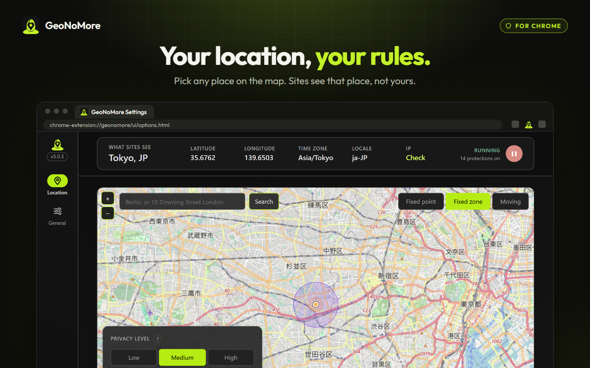
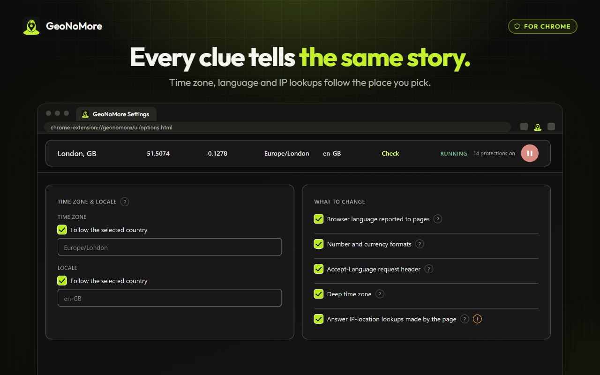
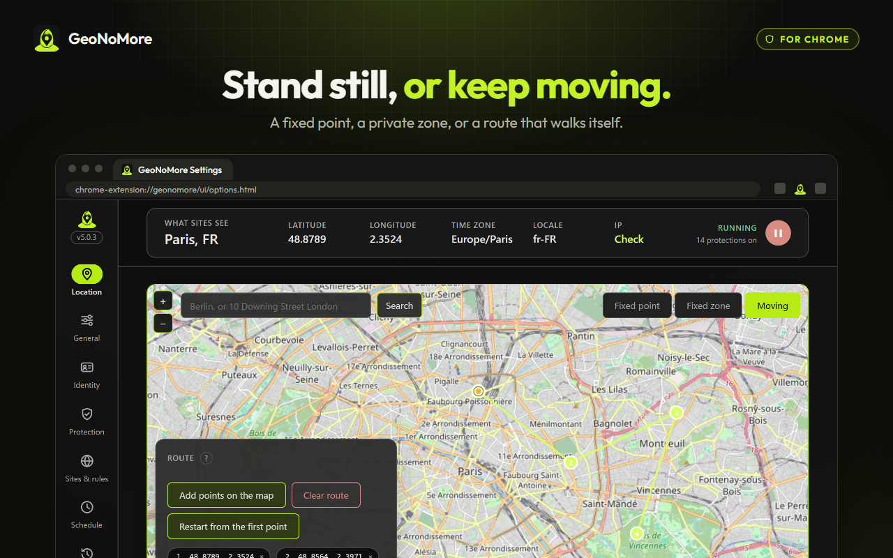
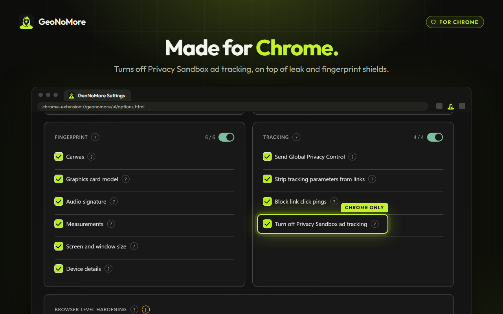
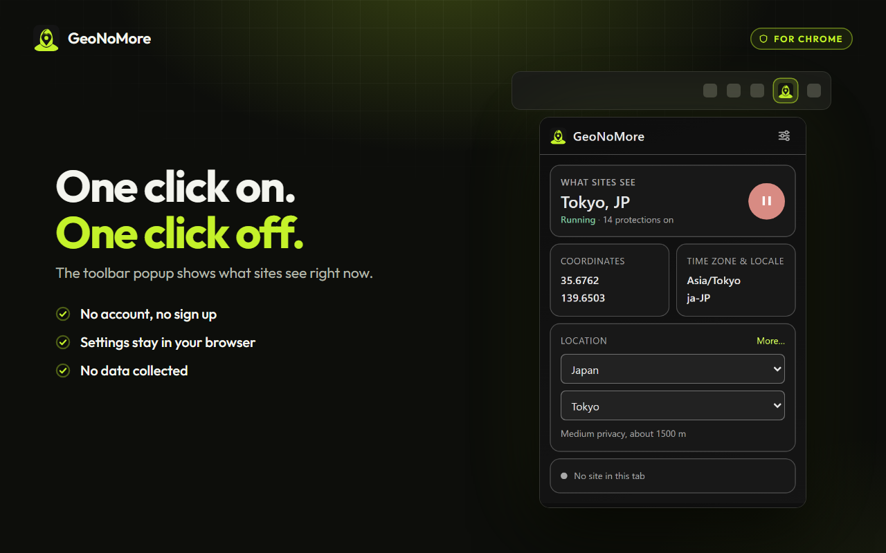

<div align="center">

<picture>
  <source media="(prefers-color-scheme: dark)" srcset="../../assets/logo-dark.svg">
  
</picture>

# GeoNoMore

**Falsea tu ubicación GPS en Chrome y Firefox, con la zona horaria y el idioma en sintonía para que nada te delate.**

[](../../LICENSE)
[](https://github.com/Miabeyefendi/GeoNoMore/releases/latest)
[](#)
[](#)
[](https://github.com/Miabeyefendi)

[English](../../README.md) · [Türkçe](../../docs/locales/README_TR.md) · **Español** · [简体中文](../../docs/locales/README_ZH.md) · [Русский](../../docs/locales/README_RU.md)

[Instalar](#-instalación) · [Funciones](#-lo-destacado) · [Uso](#-inicio-rápido) · [Cambios](../../CHANGELOG.md)

<a href="https://github.com/Miabeyefendi/GeoNoMore/releases/latest">
  
</a>



</div>

---

## ✨ Lo destacado

- **Ubicación GPS falsa** - cada sitio que pregunta dónde estás recibe el lugar que elegiste, incluido el seguimiento en vivo con watchPosition
- **Zona horaria e idioma en sintonía** - Intl, Date, Temporal, navigator.language y Accept-Language coinciden con el lugar falso
- **Tres modos** - un punto fijo, un punto al azar dentro de una zona de privacidad o una ruta que camina, pedalea o conduce sola
- **Reglas por sitio** - en todas partes, solo en una lista o en todas partes salvo una lista, y un sitio puede tener su propia ubicación
- **Protección contra fugas** - IP local por WebRTC, web workers, marcos que crea la página y consultas de IP que hace la propia página
- **Protección contra el rastreo** - Global Privacy Control, etiquetas de rastreo quitadas de los enlaces, pings de enlaces y resolución DNS anticipada desactivados
- **Hecho para cada navegador** - rastreo publicitario de Privacy Sandbox desactivado en Chrome, protección contra el rastreo en todas las ventanas en Firefox
- **Comprobación de IP y registro completo** - ves dónde aparece tu conexión real y cada ubicación entregada a cada sitio
- **Privado por diseño** - sin cuenta, sin telemetría, los ajustes se quedan en tu navegador

---

## 📦 Instalación

### Requisitos

| | |
|---|---|
| Chrome, Edge, Brave, Opera | versión 111 o posterior |
| Firefox | versión 140 o posterior, Firefox para Android 142 o posterior |
| Compilar desde el código | Node.js 18 o posterior, nada más que instalar |

### Construido con


### Instalar

Lo más fácil es la tienda de tu navegador: [Chrome Web Store](https://chromewebstore.google.com/detail/geonomore/idnfgjkaoakajojpoljeampjdakpncoe) · [Complementos de Firefox](https://addons.mozilla.org/firefox/addon/geonomore/). Para compilarlo tú:

```bash
git clone https://github.com/Miabeyefendi/GeoNoMore.git
cd GeoNoMore
node src/tools/build.js
```

<details>
<summary><b>Instalar desde una versión publicada</b></summary>

1. Descarga el zip de tu navegador desde la [página de versiones](https://github.com/Miabeyefendi/GeoNoMore/releases/latest).
2. Chrome, Edge, Brave u Opera: descomprime `geonomore-chromium-*.zip`, abre `chrome://extensions`, activa el modo de desarrollador y elige "Cargar descomprimida" sobre la carpeta.
3. Firefox: abre `about:debugging`, elige "Este Firefox" y luego "Cargar complemento temporal" con `geonomore-firefox-*.zip`. Un complemento temporal se quita al cerrar Firefox, la versión de la tienda se queda.

Archivos adjuntos a cada versión, compilados desde este repositorio con `node src/tools/build.js`, JavaScript plano, sin minificar:

| Archivo | Qué es | SHA-256 (5.1.0) |
|---|---|---|
| `geonomore-chromium-5.1.0.zip` | Paquete para Chrome, Edge, Brave y Opera | `57865ff86b4efce22d2edf4523074570c70984ad8e6cb7c084473d6b8b930410` |
| `geonomore-firefox-5.1.0.zip` | Paquete para Firefox y Firefox para Android | `58fe7958c2350a611258125103568823ce485cb3a726b02ab91e8ad6bea5d61d` |
| `geonomore-5.1.0-source.zip` | Paquete de código para la revisión de la tienda, ver [BUILD.md](../../docs/guides/BUILD.md) | `60fa1a431d6a3f247d1d69c0d4edaea07cb136d4c3109090ab29d4017b250558` |

</details>

<details>
<summary><b>Extensión de navegador (Chrome y Firefox)</b></summary>

1. Compila los dos paquetes: `node src/tools/build.js` (o añade `chromium` / `firefox` para uno).
2. Abre `chrome://extensions`, o `about:debugging` en Firefox.
3. Activa el modo de desarrollador, elige "Cargar descomprimida" con `releases/extensions/chromium`, o carga `releases/extensions/firefox/manifest.json` como complemento temporal en Firefox.

</details>

---

## 🚀 Inicio rápido

1. Haz clic en el icono de GeoNoMore en la barra de herramientas.
2. Elige un país y una ciudad.
3. Pulsa el botón de reproducir.

Cada sitio que pregunta dónde estás recibe ahora ese lugar. La franja superior de la página de ajustes muestra exactamente lo que ven los sitios: ubicación, zona horaria e idioma. Pulsa el botón otra vez y vuelve la ubicación real.

---

## 🖼️ Capturas de pantalla

<table>
<tr>
  <td align="center" width="50%">
    <br/>
    <sub><b>Todas las pistas cuentan la misma historia</b> · zona horaria, idioma y consultas de IP siguen al lugar elegido</sub>
  </td>
  <td align="center" width="50%">
    <br/>
    <sub><b>Quieto o en movimiento</b> · una ruta en el mapa que avanza sola</sub>
  </td>
</tr>
<tr>
  <td align="center" width="50%">
    <br/>
    <sub><b>Hecho para Chrome</b> · protección contra fugas, huella y rastreo, Privacy Sandbox desactivado</sub>
  </td>
  <td align="center" width="50%">
    <br/>
    <sub><b>Un clic para activar, otro para desactivar</b> · la ventana de la barra muestra lo que ven los sitios ahora</sub>
  </td>
</tr>
</table>

---

## 📖 Documentación

- [**Cambios**](../../CHANGELOG.md) - qué cambió en cada versión (en inglés)
- [**Instrucciones de compilación**](../../docs/guides/BUILD.md) - cómo se compilan los paquetes de la tienda, paso a paso (en inglés)
- [**Política de privacidad**](../../docs/store/privacy-policy.md) - qué se queda en tu dispositivo y las dos solicitudes opcionales (en inglés)
- [**Contribuir**](../../CONTRIBUTING.md) - cómo enviar un cambio
- [**Seguridad**](../../SECURITY.md) - cómo informar de una vulnerabilidad en privado

---

## 🧭 Hoja de ruta

- [ ] Proteger también los shared workers
- [ ] Elegir el idioma de la interfaz según el navegador en la primera instalación
- [ ] Probar en dispositivos con Firefox para Android
- [x] Auditoría de fugas en un navegador real, Chrome y Firefox (5.1.0)

Nada de esto es una promesa. Es un proyecto personal y la lista cambia cuando cambian mis prioridades.

---

## ❓ Preguntas frecuentes

<details>
<summary><b>¿Cambia mi dirección IP? ¿Es una VPN?</b></summary>

No. Tu dirección IP sigue igual y ninguna extensión de navegador puede cambiarla. Un sitio que busca tu ubicación en su propio servidor, a partir de tu IP, sigue viendo tu país real. Para eso necesitas una VPN. GeoNoMore cambia lo que informa el propio navegador.

</details>

<details>
<summary><b>¿Recoge algún dato?</b></summary>

No. No hay cuenta, ni analítica, ni servidor mío. Los ajustes se quedan en tu navegador. Las dos únicas solicitudes de red son la búsqueda de direcciones opcional (OpenStreetMap) y la comprobación de IP opcional, y solo se ejecutan al pulsar su botón. Ver la [política de privacidad](../../docs/store/privacy-policy.md).

</details>

<details>
<summary><b>Dejó de funcionar tras una actualización. ¿Y ahora qué?</b></summary>

Primero recarga la página, el parche solo llega a las páginas abiertas después de activarlo. Luego mira la pestaña Sitios, puede que el sitio esté excluido. Si sigue fallando, abre la pestaña Historial, reproduce el problema, copia el registro y [abre un issue](https://github.com/Miabeyefendi/GeoNoMore/issues/new?template=bug_report.yml). Lee el registro antes de enviarlo, lista los sitios que visitaste.

</details>

---

## 🤝 Contribuir

Las contribuciones son bienvenidas. Lee primero [CONTRIBUTING.md](../../CONTRIBUTING.md)
y [CODE_OF_CONDUCT.md](../../CODE_OF_CONDUCT.md). Al contribuir aceptas licenciar tu
trabajo bajo la Licencia GeoNoMore.

<div align="center">
<a href="https://github.com/Miabeyefendi/GeoNoMore/issues/new?template=bug_report.yml">
  <picture>
    <source media="(prefers-color-scheme: dark)" srcset="./assets/btn-report-bug-dark.svg">
    
  </picture>
</a>
<a href="https://github.com/Miabeyefendi/GeoNoMore/stargazers">
  <picture>
    <source media="(prefers-color-scheme: dark)" srcset="./assets/btn-star-dark.svg">
    
  </picture>
</a>
</div>

---

## 🛡️ Seguridad

¿Has encontrado una vulnerabilidad? No abras una incidencia pública. Sigue el
proceso privado descrito en [SECURITY.md](../../SECURITY.md).

---

## 📜 Licencia

Este proyecto tiene el **codigo a la vista, pero no es open source**. El texto
completo esta en [LICENSE](../../LICENSE) y los terminos adicionales en
[NOTICE](../../NOTICE). En resumen:

- Puedes leer el codigo, auditarlo, modificarlo en tu propia maquina y enviar los
  cambios de vuelta. Las contribuciones son bienvenidas, para eso esta publico.
- **No** puedes publicarlo, replicarlo, subirlo a ninguna tienda ni ganar dinero
  con el de ninguna forma. GeoNoMore lo publica su autor y nadie mas.
- Si necesitas algo que la licencia no permite, escribe. El contacto esta abajo.

### Atribución (obligatoria)

Según la licencia, la siguiente atribución debe conservarse de
forma visible y sin modificar en cualquier copia, bifurcación o despliegue de
este proyecto:

> **Miabeyefendi (Mustafa Ihsan Albayrak)** - https://github.com/Miabeyefendi

### Descargo de responsabilidad

Este software se proporciona "tal cual", sin garantía de ningún tipo. Lo ejecutas
por tu cuenta y riesgo y eres la única persona responsable de tu propio uso,
incluido el cumplimiento de los términos de servicio de cualquier plataforma de
terceros con la que interactúe. Esas plataformas no están afiliadas al autor ni
lo respaldan; sus nombres y marcas pertenecen a sus respectivos propietarios. El
autor no acepta responsabilidad alguna por bloqueos de cuenta, pérdida de datos
ni ningún otro daño, en la máxima medida permitida por la ley aplicable. Los
términos completos están en los archivos [LICENSE](../../LICENSE) y
[NOTICE](../../NOTICE).

---

## 📬 Contacto

- GitHub: [@miabeyefendi](https://github.com/Miabeyefendi)
- Para licencias comerciales o consultas sobre reparto de ingresos, escríbeme a
  través de mi perfil de GitHub.

<div align="center">
<br/>

<br/>
<sub>Creado por <b><a href="https://github.com/Miabeyefendi">Miabeyefendi</a></b></sub>
</div>
