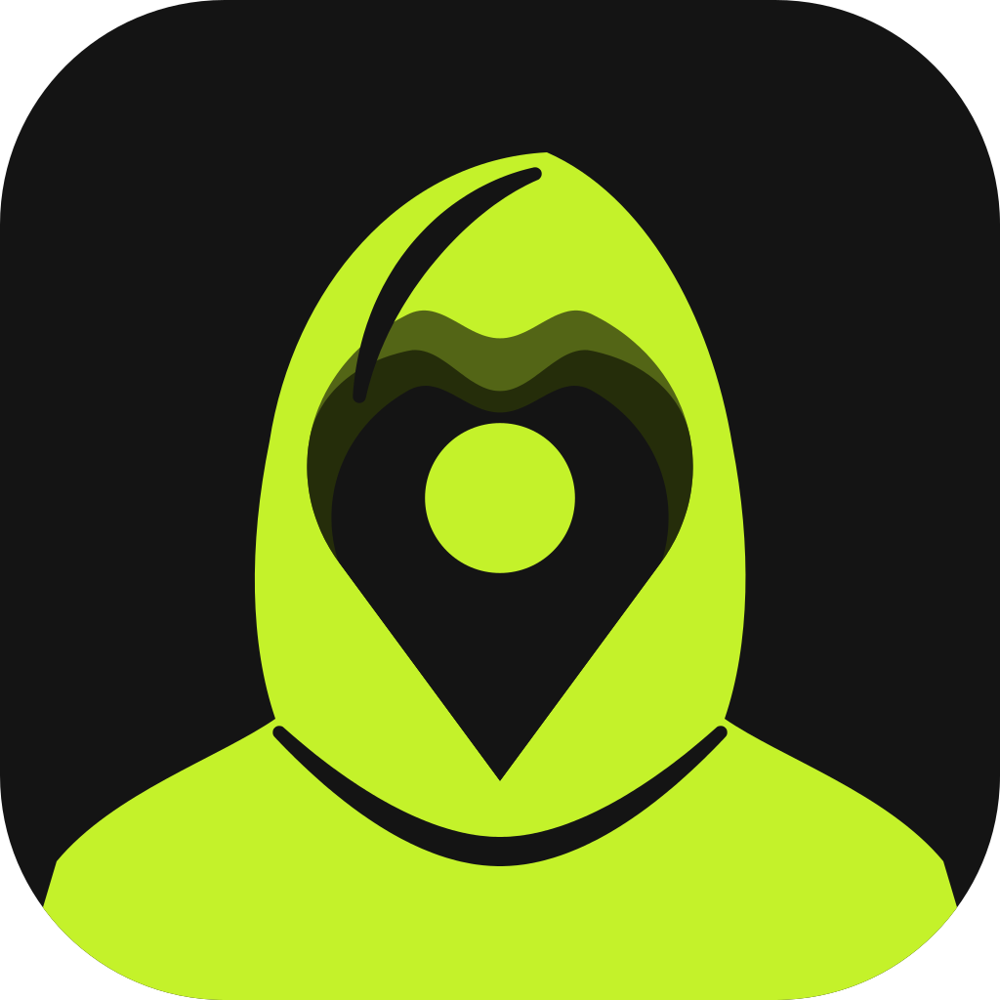
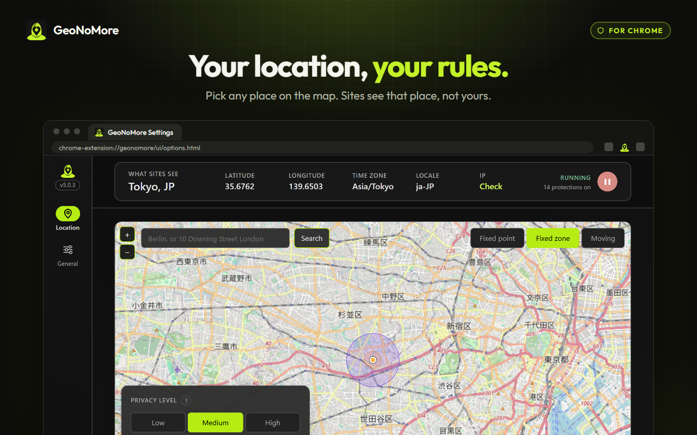
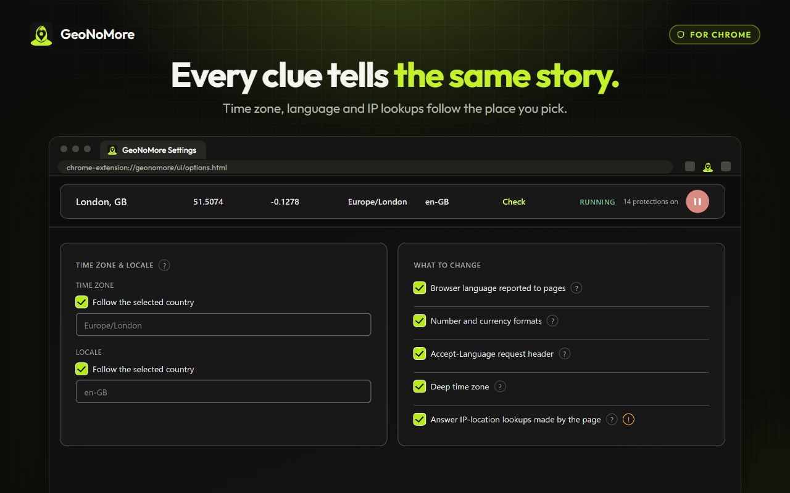
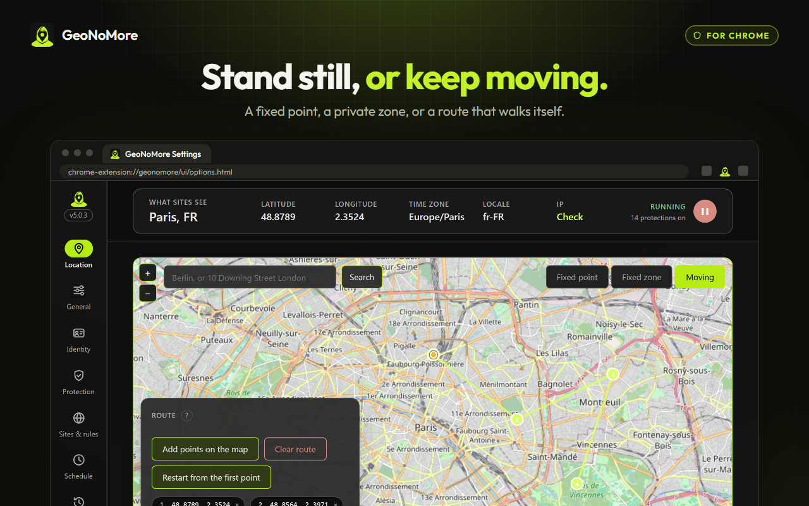
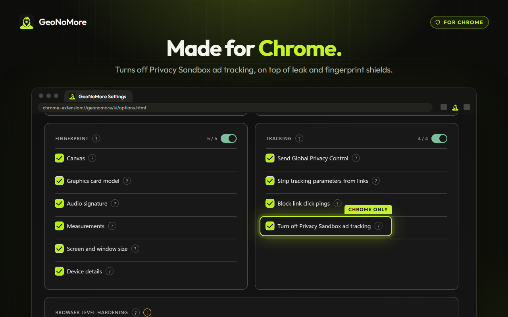
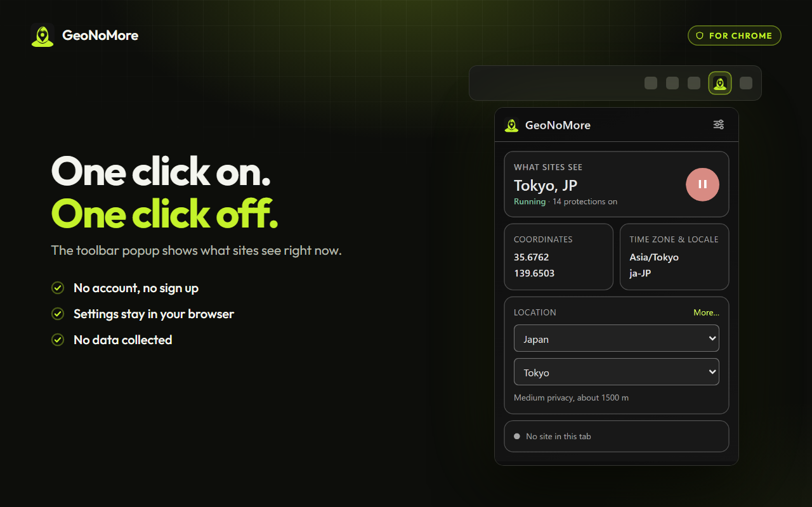

<div align="center">

<picture>
  <source media="(prefers-color-scheme: dark)" srcset="../../assets/logo-dark.svg">
  
</picture>

# GeoNoMore

**Подменяйте GPS-местоположение в Chrome и Firefox, а часовой пояс и язык подстроятся под него, чтобы ничто вас не выдало.**

[](../../LICENSE)
[](https://github.com/Miabeyefendi/GeoNoMore/releases/latest)
[](#)
[](#)
[](https://github.com/Miabeyefendi)

[English](../../README.md) · [Türkçe](../../docs/locales/README_TR.md) · [Español](../../docs/locales/README_ES.md) · [简体中文](../../docs/locales/README_ZH.md) · **Русский**

[Установка](#-установка) · [Возможности](#-главное) · [Использование](#-быстрый-старт) · [Изменения](../../CHANGELOG.md)

<a href="https://github.com/Miabeyefendi/GeoNoMore/releases/latest">
  
</a>



</div>

---

## ✨ Главное

- **Поддельное GPS-местоположение** - каждый сайт, который спрашивает, где вы, получает выбранное место, включая слежение watchPosition
- **Часовой пояс и язык в согласии** - Intl, Date, Temporal, navigator.language и Accept-Language совпадают с поддельным местом
- **Три режима** - фиксированная точка, случайная точка в зоне приватности или маршрут, который сам идёт, едет на велосипеде или на машине
- **Правила для сайтов** - везде, только по списку или везде кроме списка, и у одного сайта может быть своё местоположение
- **Защита от утечек** - локальный IP через WebRTC, web workers, фреймы, которые создаёт страница, и IP-запросы самой страницы
- **Защита от слежки** - Global Privacy Control, удаление меток слежения из ссылок, отключение пингов ссылок и предварительного DNS
- **Под каждый браузер** - в Chrome отключено рекламное отслеживание Privacy Sandbox, в Firefox защита от слежки во всех окнах
- **Проверка IP и полный журнал** - видно, где появляется ваше реальное соединение и какое местоположение получил каждый сайт
- **Приватность по замыслу** - без аккаунта, без телеметрии, настройки остаются в браузере

---

## 📦 Установка

### Требования

| | |
|---|---|
| Chrome, Edge, Brave, Opera | версия 111 или новее |
| Firefox | версия 140 или новее, Firefox для Android 142 или новее |
| Сборка из исходников | Node.js 18 или новее, больше ничего ставить не нужно |

### На чём собрано


### Установить

Проще всего через магазин вашего браузера: [Интернет-магазин Chrome](https://chromewebstore.google.com/detail/geonomore/idnfgjkaoakajojpoljeampjdakpncoe) · [Дополнения Firefox](https://addons.mozilla.org/firefox/addon/geonomore/). Собрать самому:

```bash
git clone https://github.com/Miabeyefendi/GeoNoMore.git
cd GeoNoMore
node src/tools/build.js
```

<details>
<summary><b>Установить из готового релиза</b></summary>

1. Скачайте zip для вашего браузера со [страницы релизов](https://github.com/Miabeyefendi/GeoNoMore/releases/latest).
2. Chrome, Edge, Brave или Opera: распакуйте `geonomore-chromium-*.zip`, откройте `chrome://extensions`, включите режим разработчика и выберите "Загрузить распакованное расширение" для этой папки.
3. Firefox: откройте `about:debugging`, выберите "Этот Firefox", затем "Загрузить временное дополнение" и укажите `geonomore-firefox-*.zip`. Временное дополнение удаляется при закрытии Firefox, версия из магазина остаётся.

Файлы, прикреплённые к каждому релизу, собраны из этого репозитория командой `node src/tools/build.js`, обычный JavaScript без минификации:

| Файл | Что это | SHA-256 (5.1.1) |
|---|---|---|
| `geonomore-chromium-5.1.1.zip` | Пакет для Chrome, Edge, Brave и Opera | `94160f432482d6da585ac31c5ffb97ec7450336d93cecb85dd122264efdc806c` |
| `geonomore-firefox-5.1.1.zip` | Пакет для Firefox и Firefox для Android | `827dc68021697ceefea5b8e4e1da968ef3f46a7ecfd1bf0e8b984a0366540f27` |
| `geonomore-5.1.1-source.zip` | Пакет исходников для проверки в магазине, см. [BUILD.md](../../docs/guides/BUILD.md) | `2677dcae1769e1e18b9813399521f15e77363254c7139d67916ad7b607d8e5dd` |

</details>

<details>
<summary><b>Расширение для браузера (Chrome и Firefox)</b></summary>

1. Соберите оба пакета: `node src/tools/build.js` (или добавьте `chromium` / `firefox` для одного).
2. Откройте `chrome://extensions`, в Firefox `about:debugging`.
3. Включите режим разработчика, выберите "Загрузить распакованное расширение" и папку `releases/extensions/chromium`, а в Firefox загрузите `releases/extensions/firefox/manifest.json` как временное дополнение.

</details>

---

## 🚀 Быстрый старт

1. Нажмите на значок GeoNoMore на панели инструментов.
2. Выберите страну и город.
3. Нажмите кнопку воспроизведения.

Теперь каждый сайт, который спрашивает, где вы, получает это место. Верхняя полоса страницы настроек показывает, что именно видят сайты: местоположение, часовой пояс и язык. Нажмите кнопку ещё раз, и вернётся реальное местоположение.

---

## 🖼️ Скриншоты

<table>
<tr>
  <td align="center" width="50%">
    <br/>
    <sub><b>Все улики говорят одно и то же</b> · часовой пояс, язык и IP-запросы следуют за выбранным местом</sub>
  </td>
  <td align="center" width="50%">
    <br/>
    <sub><b>Стоять или двигаться</b> · маршрут на карте, который идёт сам</sub>
  </td>
</tr>
<tr>
  <td align="center" width="50%">
    <br/>
    <sub><b>Сделано для Chrome</b> · защита от утечек, отпечатка и слежки, Privacy Sandbox отключён</sub>
  </td>
  <td align="center" width="50%">
    <br/>
    <sub><b>Включить и выключить одним кликом</b> · окно на панели показывает, что сайты видят прямо сейчас</sub>
  </td>
</tr>
</table>

---

## 📖 Документация

- [**Изменения**](../../CHANGELOG.md) - что изменилось в каждом релизе (на английском)
- [**Инструкция по сборке**](../../docs/guides/BUILD.md) - как по шагам собираются пакеты для магазинов (на английском)
- [**Политика конфиденциальности**](../../docs/store/privacy-policy.md) - что остаётся на устройстве и два необязательных запроса (на английском)
- [**Участие**](../../CONTRIBUTING.md) - как прислать изменение
- [**Безопасность**](../../SECURITY.md) - как сообщить об уязвимости приватно

---

## 🧭 Планы

- [ ] Защищать и shared workers
- [ ] Выбирать язык интерфейса по браузеру при первой установке
- [ ] Проверить на устройствах с Firefox для Android
- [x] Аудит утечек в настоящих Chrome и Firefox (5.1.0)

Здесь нет обещаний. Это личный проект, и список меняется вместе с моими приоритетами.

---

## ❓ Частые вопросы

<details>
<summary><b>Меняет ли это мой IP-адрес? Это VPN?</b></summary>

Нет. Ваш IP-адрес остаётся прежним, и никакое расширение браузера не может его изменить. Сайт, который определяет местоположение на своём сервере по IP, по-прежнему видит вашу настоящую страну. Для этого нужен VPN. GeoNoMore меняет то, что сообщает сам браузер.

</details>

<details>
<summary><b>Собирает ли оно данные?</b></summary>

Нет. Нет аккаунта, нет аналитики, нет моего сервера. Настройки остаются в браузере. Единственные два сетевых запроса: необязательный поиск адреса (OpenStreetMap) и необязательная проверка IP, и оба выполняются только по нажатию своей кнопки. См. [политику конфиденциальности](../../docs/store/privacy-policy.md).

</details>

<details>
<summary><b>После обновления перестало работать. Что делать?</b></summary>

Сначала обновите страницу, патч действует только на страницы, открытые после включения. Затем проверьте вкладку Сайты, сайт может быть исключён. Если не помогло, откройте вкладку История, повторите проблему, скопируйте журнал и [создайте issue](https://github.com/Miabeyefendi/GeoNoMore/issues/new?template=bug_report.yml). Прочитайте журнал перед отправкой, в нём перечислены посещённые сайты.

</details>

---

## 🤝 Участие

Вклад приветствуется. Сначала прочитайте [CONTRIBUTING.md](../../CONTRIBUTING.md) и
[CODE_OF_CONDUCT.md](../../CODE_OF_CONDUCT.md). Внося вклад, вы соглашаетесь
лицензировать свою работу под лицензией GeoNoMore.

<div align="center">
<a href="https://github.com/Miabeyefendi/GeoNoMore/issues/new?template=bug_report.yml">
  <picture>
    <source media="(prefers-color-scheme: dark)" srcset="./assets/btn-report-bug-dark.svg">
    
  </picture>
</a>
<a href="https://github.com/Miabeyefendi/GeoNoMore/stargazers">
  <picture>
    <source media="(prefers-color-scheme: dark)" srcset="./assets/btn-star-dark.svg">
    
  </picture>
</a>
</div>

---

## 🛡️ Безопасность

Нашли уязвимость? Не открывайте публичный issue. Следуйте приватной процедуре из
[SECURITY.md](../../SECURITY.md).

---

## 📜 Лицензия

Исходный код открыт для чтения, но это **не open source**. Полный текст в
[LICENSE](../../LICENSE), дополнительные условия в [NOTICE](../../NOTICE). Коротко:

- Можно читать код, проверять его, менять на своей машине и присылать изменения
  обратно. Вклад приветствуется, ради этого код и опубликован.
- **Нельзя** публиковать, копировать в другие места, выкладывать в магазины и
  зарабатывать на нём. GeoNoMore публикует его автор и никто другой.
- Нужно то, что лицензия не разрешает? Напишите, контакт ниже.

### Атрибуция (обязательна)

Согласно лицензии, следующая атрибуция должна сохраняться на
видном месте и без изменений в любой копии, форке или развёртывании проекта:

> **Miabeyefendi (Mustafa Ihsan Albayrak)** - https://github.com/Miabeyefendi

### Отказ от ответственности

Программа предоставляется «как есть», без каких-либо гарантий. Вы запускаете её
целиком на свой страх и риск и несёте единоличную ответственность за собственное
использование, включая соблюдение условий обслуживания любой сторонней
платформы, с которой она взаимодействует. Эти платформы не связаны с автором и
не одобряют его работу; их названия и товарные знаки принадлежат их владельцам.
Автор не несёт ответственности за блокировки аккаунтов, потерю данных и любой
другой ущерб в максимальной степени, допустимой применимым правом. Полные
условия в файлах [LICENSE](../../LICENSE) и [NOTICE](../../NOTICE).

---

## 📬 Контакты

- GitHub: [@miabeyefendi](https://github.com/Miabeyefendi)
- По вопросам коммерческого лицензирования или разделения дохода пишите через мой
  профиль GitHub.

<div align="center">
<br/>

<br/>
<sub>Сделано <b><a href="https://github.com/Miabeyefendi">Miabeyefendi</a></b></sub>
</div>
