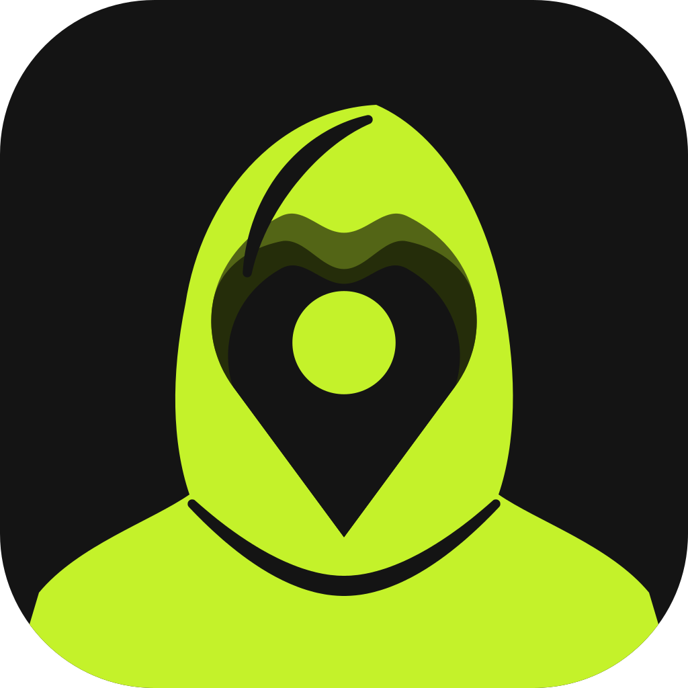
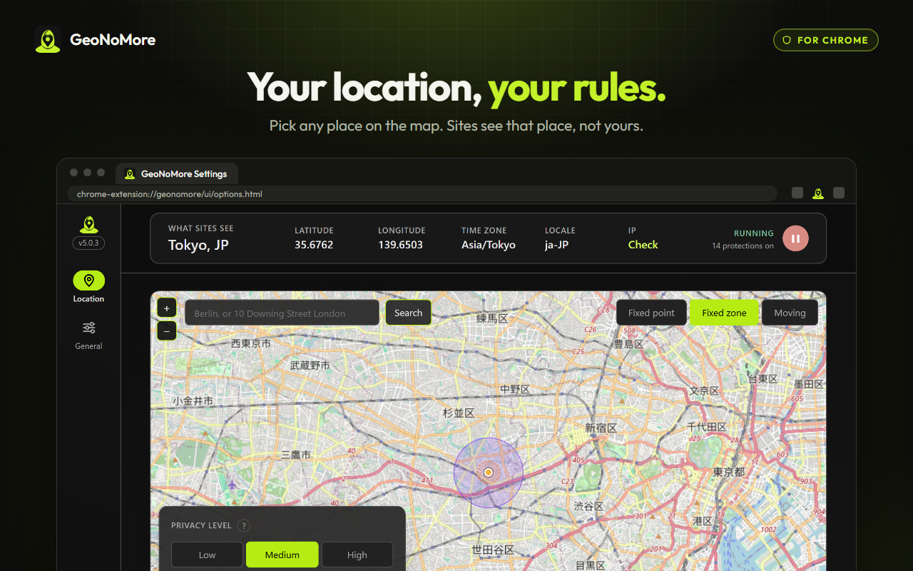
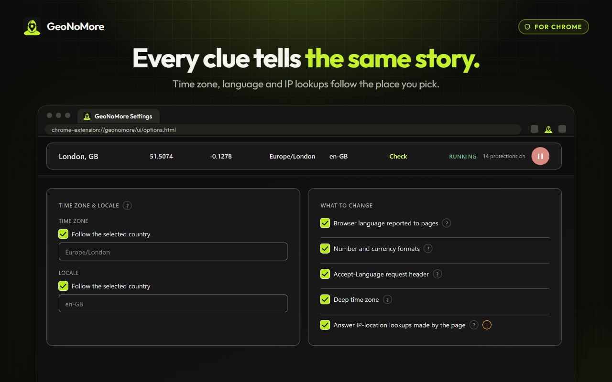
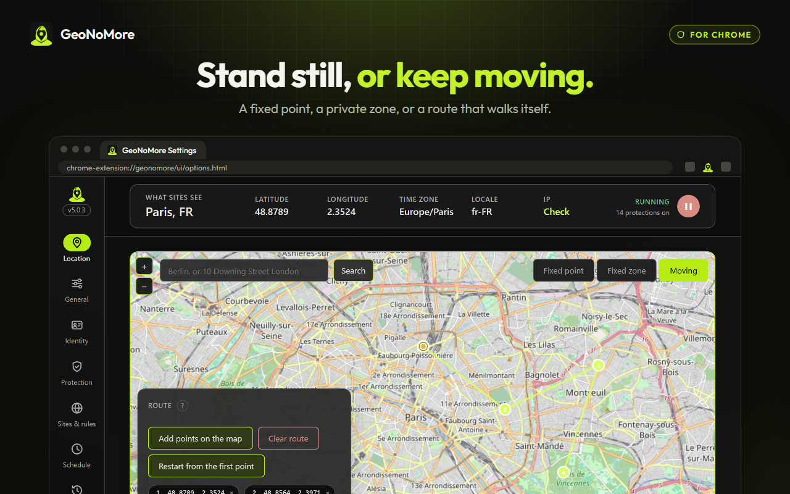
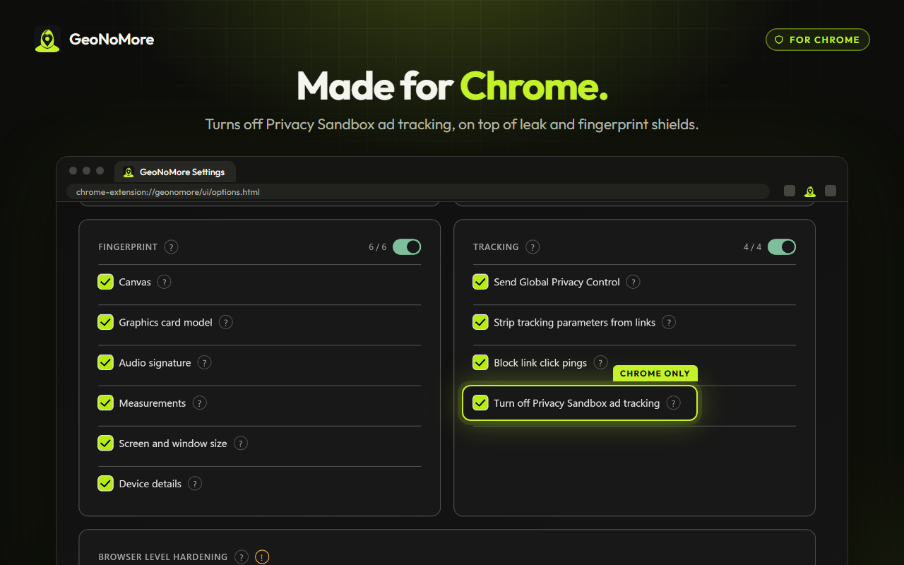
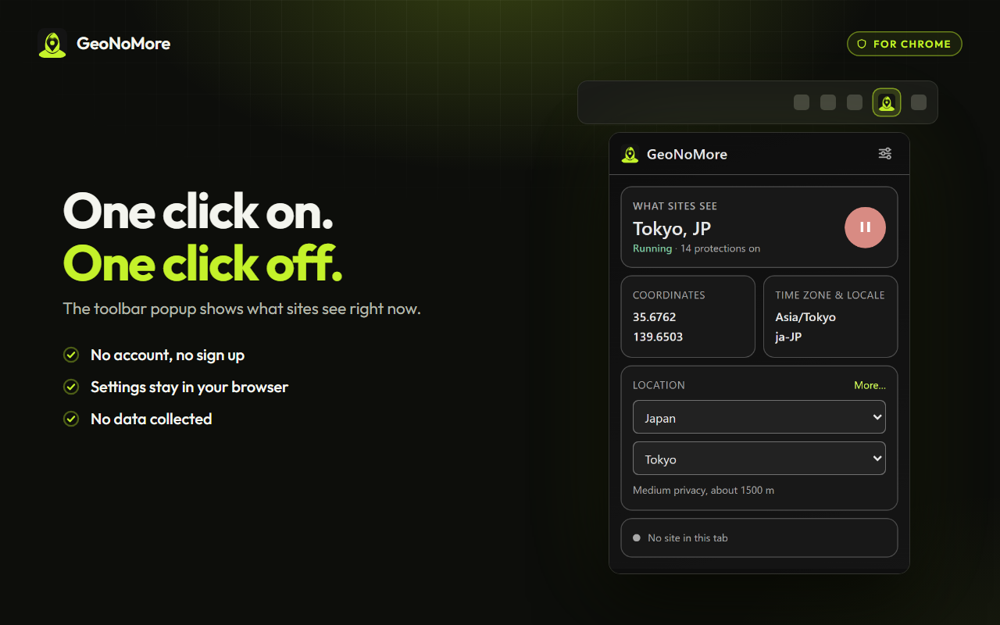

<div align="center">

<picture>
  <source media="(prefers-color-scheme: dark)" srcset="../../assets/logo-dark.svg">
  
</picture>

# GeoNoMore

**Chrome ve Firefox'ta GPS konumunu sahtele; saat dilimi ve dil de onunla uyumlu kalsın, hiçbir şey seni ele vermesin.**

[](../../LICENSE)
[](https://github.com/Miabeyefendi/GeoNoMore/releases/latest)
[](#)
[](#)
[](https://github.com/Miabeyefendi)

[English](../../README.md) · **Türkçe** · [Español](../../docs/locales/README_ES.md) · [简体中文](../../docs/locales/README_ZH.md) · [Русский](../../docs/locales/README_RU.md)

[Kurulum](#-kurulum) · [Özellikler](#-öne-çıkanlar) · [Kullanım](#-hızlı-başlangıç) · [Değişiklikler](../../CHANGELOG.md)

<a href="https://github.com/Miabeyefendi/GeoNoMore/releases/latest">
  
</a>



</div>

---

## ✨ Öne çıkanlar

- **Sahte GPS konumu** - nerede olduğunu soran her site seçtiğin yeri alır, canlı watchPosition takibi dahil
- **Uyumlu saat dilimi ve dil** - Intl, Date, Temporal, navigator.language ve Accept-Language sahte yerle aynı şeyi söyler
- **Üç mod** - sabit nokta, gizlilik bölgesi içinde rastgele nokta ya da kendi kendine yürüyen, bisiklete binen veya araba süren bir rota
- **Site başına kurallar** - her yerde, yalnız bir listede ya da liste dışında her yerde çalışır; bir siteye kendi konumunu verebilirsin
- **Sızıntı koruması** - WebRTC yerel IP, web worker'lar, sayfanın açtığı çerçeveler ve sayfanın kendi yaptığı IP sorguları
- **Takip koruması** - Global Privacy Control, bağlantılardan takip etiketleri temizlenir, bağlantı ping'leri ve DNS ön çözümleme kapanır
- **Her tarayıcıya göre** - Chrome'da Privacy Sandbox reklam takibi kapalı, Firefox'ta her pencerede takip koruması
- **IP kontrolü ve tam kayıt** - gerçek bağlantının nerede göründüğünü ve her siteye verilen her konumu görürsün
- **Tasarımdan gizli** - hesap yok, telemetri yok, ayarlar tarayıcında kalır

---

## 📦 Kurulum

### Gereksinimler

| | |
|---|---|
| Chrome, Edge, Brave, Opera | 111 veya üstü |
| Firefox | 140 veya üstü, Android için Firefox 142 veya üstü |
| Kaynaktan derlemek | Node.js 18 veya üstü, başka kurulacak bir şey yok |

### Kullanılan teknolojiler


### Kur

En kolay yol tarayıcının mağaza sayfası: [Chrome Web Mağazası](https://chromewebstore.google.com/detail/geonomore/idnfgjkaoakajojpoljeampjdakpncoe) · [Firefox Eklentileri](https://addons.mozilla.org/firefox/addon/geonomore/). Kendin derlemek için:

```bash
git clone https://github.com/Miabeyefendi/GeoNoMore.git
cd GeoNoMore
node src/tools/build.js
```

<details>
<summary><b>Bunun yerine hazır sürümden kur</b></summary>

1. Tarayıcına uygun zip'i [sürümler sayfasından](https://github.com/Miabeyefendi/GeoNoMore/releases/latest) indir.
2. Chrome, Edge, Brave ya da Opera: `geonomore-chromium-*.zip` dosyasını aç, `chrome://extensions` sayfasında geliştirici modunu aç ve açtığın klasör için "Paketlenmemiş öğe yükle"yi seç.
3. Firefox: `about:debugging` aç, "Bu Firefox"u seç, sonra "Geçici Eklenti Yükle" ile `geonomore-firefox-*.zip` dosyasını seç. Geçici eklenti Firefox kapanınca kalkar, mağaza sürümü kalır.

Her sürüme eklenen dosyalar; bu depodan `node src/tools/build.js` ile derlenir, düz JavaScript, küçültülmemiş:

| Dosya | Ne olduğu | SHA-256 (5.1.0) |
|---|---|---|
| `geonomore-chromium-5.1.0.zip` | Chrome, Edge, Brave ve Opera paketi | `57865ff86b4efce22d2edf4523074570c70984ad8e6cb7c084473d6b8b930410` |
| `geonomore-firefox-5.1.0.zip` | Firefox ve Android için Firefox paketi | `58fe7958c2350a611258125103568823ce485cb3a726b02ab91e8ad6bea5d61d` |
| `geonomore-5.1.0-source.zip` | Mağaza incelemesi için kaynak paketi, bkz. [BUILD.md](../../docs/guides/BUILD.md) | `60fa1a431d6a3f247d1d69c0d4edaea07cb136d4c3109090ab29d4017b250558` |

</details>

<details>
<summary><b>Tarayıcı eklentisi (Chrome ve Firefox)</b></summary>

1. İki paketi derle: `node src/tools/build.js` (tek tarayıcı için sonuna `chromium` ya da `firefox` ekle).
2. `chrome://extensions` aç, Firefox'ta `about:debugging`.
3. Geliştirici modunu aç, "Paketlenmemiş öğe yükle" ile `releases/extensions/chromium` klasörünü seç; Firefox'ta `releases/extensions/firefox/manifest.json` dosyasını geçici eklenti olarak yükle.

</details>

---

## 🚀 Hızlı başlangıç

1. Araç çubuğundaki GeoNoMore simgesine tıkla.
2. Bir ülke ve şehir seç.
3. Oynat düğmesine bas.

Nerede olduğunu soran her site artık o yeri alır. Ayar sayfasının üst şeridi sitelerin tam olarak ne gördüğünü gösterir: konum, saat dilimi ve dil. Düğmeye tekrar basınca gerçek konum geri gelir.

---

## 🖼️ Ekran görüntüleri

<table>
<tr>
  <td align="center" width="50%">
    <br/>
    <sub><b>Her ipucu aynı şeyi söyler</b> · saat dilimi, dil ve IP sorguları seçtiğin yere uyar</sub>
  </td>
  <td align="center" width="50%">
    <br/>
    <sub><b>Dur ya da hareket et</b> · haritada kendi kendine yürüyen bir rota</sub>
  </td>
</tr>
<tr>
  <td align="center" width="50%">
    <br/>
    <sub><b>Chrome için yapıldı</b> · sızıntı, parmak izi ve takip koruması, Privacy Sandbox kapalı</sub>
  </td>
  <td align="center" width="50%">
    <br/>
    <sub><b>Tek tıkla aç, tek tıkla kapat</b> · araç çubuğu penceresi sitelerin şu an ne gördüğünü gösterir</sub>
  </td>
</tr>
</table>

---

## 📖 Belgeler

- [**Değişiklikler**](../../CHANGELOG.md) - her sürümde ne değişti (İngilizce)
- [**Derleme talimatı**](../../docs/guides/BUILD.md) - mağaza paketlerinin adım adım nasıl derlendiği (İngilizce)
- [**Gizlilik politikası**](../../docs/store/privacy-policy.md) - cihazında ne kalıyor ve iki isteğe bağlı istek (İngilizce)
- [**Katkıda bulunma**](../../CONTRIBUTING.md) - bir değişiklik nasıl gönderilir
- [**Güvenlik**](../../SECURITY.md) - bir açık özel olarak nasıl bildirilir

---

## 🧭 Yol haritası

- [ ] Paylaşılan worker'ları da korumak
- [ ] İlk kurulumda arayüz dilini tarayıcıdan seçmek
- [ ] Android için Firefox'ta gerçek cihaz testi
- [x] Chrome ve Firefox'ta gerçek tarayıcı sızıntı denetimi (5.1.0)

Buradaki hiçbir şey söz değildir. Bu kişisel bir proje, önceliklerim değiştikçe liste de değişir.

---

## ❓ Sık sorulanlar

<details>
<summary><b>IP adresimi değiştirir mi? VPN mi?</b></summary>

Hayır. IP adresin aynı kalır ve hiçbir tarayıcı eklentisi onu değiştiremez. Konumunu kendi sunucusunda, IP'nden bulan bir site gerçek ülkeni görmeye devam eder. Bunun için VPN gerekir. GeoNoMore tarayıcının kendisinin bildirdiğini değiştirir.

</details>

<details>
<summary><b>Veri topluyor mu?</b></summary>

Hayır. Hesap yok, analitik yok, benim bir sunucum yok. Ayarlar tarayıcında kalır. Yalnız iki ağ isteği var: isteğe bağlı adres araması (OpenStreetMap) ve isteğe bağlı IP kontrolü; ikisi de yalnız düğmesine basınca çalışır. Bkz. [gizlilik politikası](../../docs/store/privacy-policy.md).

</details>

<details>
<summary><b>Güncellemeden sonra çalışmayı bıraktı, ne yapmalıyım?</b></summary>

Önce sayfayı yenile; yama yalnız açıldıktan sonra açılan sayfalara ulaşır. Sonra Siteler sekmesine bak, site hariç tutulmuş olabilir. Hâlâ olmuyorsa Geçmiş sekmesini aç, sorunu tekrarla, kaydı kopyala ve [bir issue aç](https://github.com/Miabeyefendi/GeoNoMore/issues/new?template=bug_report.yml). Göndermeden önce kaydı oku, ziyaret ettiğin siteleri listeler.

</details>

---

## 🤝 Katkıda bulunma

Katkılar memnuniyetle karşılanır. Önce [CONTRIBUTING.md](../../CONTRIBUTING.md) ve
[CODE_OF_CONDUCT.md](../../CODE_OF_CONDUCT.md) dosyalarını oku. Katkıda bulunarak
eserini GeoNoMore Lisansı altında lisanslamayı kabul edersin.

<div align="center">
<a href="https://github.com/Miabeyefendi/GeoNoMore/issues/new?template=bug_report.yml">
  <picture>
    <source media="(prefers-color-scheme: dark)" srcset="./assets/btn-report-bug-dark.svg">
    
  </picture>
</a>
<a href="https://github.com/Miabeyefendi/GeoNoMore/stargazers">
  <picture>
    <source media="(prefers-color-scheme: dark)" srcset="./assets/btn-star-dark.svg">
    
  </picture>
</a>
</div>

---

## 🛡️ Güvenlik

Bir zafiyet mi buldun? Halka açık issue açma. [SECURITY.md](../../SECURITY.md)
dosyasındaki özel süreci izle.

---

## 📜 Lisans

Bu proje **kaynağı açık, açık kaynak değil**. Tam metin için [LICENSE](../../LICENSE),
ek şartlar için [NOTICE](../../NOTICE) dosyasına bak. Kısaca:

- Kaynağı okuyabilir, inceleyebilir, kendi makinende değiştirebilir ve değişikliği
  geri gönderebilirsin. Katkı bekleniyor, kaynak bu yüzden açık.
- Yayımlayamaz, kopyasını dağıtamaz, bir mağazaya koyamaz ve hiçbir şekilde para
  kazanamazsın. GeoNoMore'u yazarı yayımlar, başkası değil.
- Lisansın izin vermediği bir şey gerekiyorsa sor, iletişim aşağıda.

### Atıf (zorunlu)

Aşağıdaki atıf; bu projenin her kopyasında,
fork'unda veya dağıtımında görünür ve değiştirilmeden korunmalıdır:

> **Miabeyefendi (Mustafa İhsan Albayrak)** - https://github.com/Miabeyefendi

### Sorumluluk reddi

Bu yazılım, hiçbir garanti olmaksızın "olduğu gibi" sunulur. Tamamen kendi
riskinle çalıştırırsın ve kendi kullanımından, etkileştiği herhangi bir üçüncü
taraf platformun kullanım koşullarına uymak dahil, yalnızca sen sorumlusun. Bu
platformlar yazarla bağlı veya yazar tarafından onaylanmış değildir; adları ve
ticari markaları ilgili sahiplerine aittir. Yazar; hesap yasakları, veri kaybı
veya başka herhangi bir zarardan, uygulanabilir yasanın izin verdiği azami ölçüde
sorumlu değildir. Tam şartlar [LICENSE](../../LICENSE) ve [NOTICE](../../NOTICE)
dosyalarındadır.

---

## 📬 İletişim

- GitHub: [@miabeyefendi](https://github.com/Miabeyefendi)
- Ticari lisanslama veya gelir paylaşımı için GitHub profilim üzerinden bana
  ulaş.

<div align="center">
<br/>

<br/>
<sub><b><a href="https://github.com/Miabeyefendi">Miabeyefendi</a></b> tarafından yapıldı</sub>
</div>
