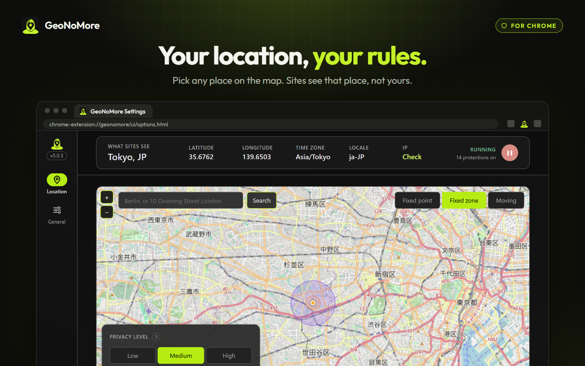
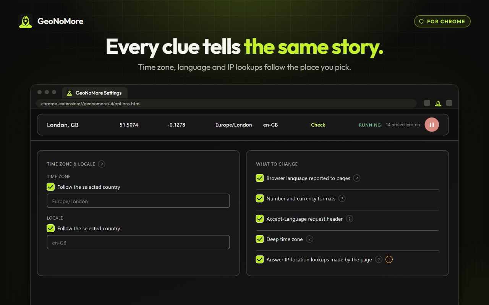
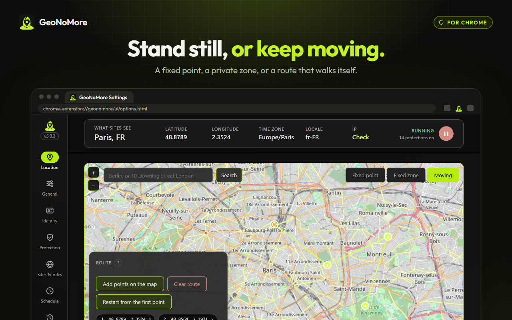
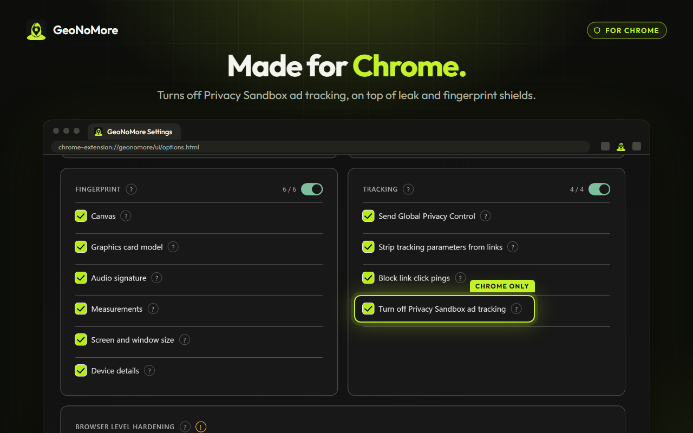
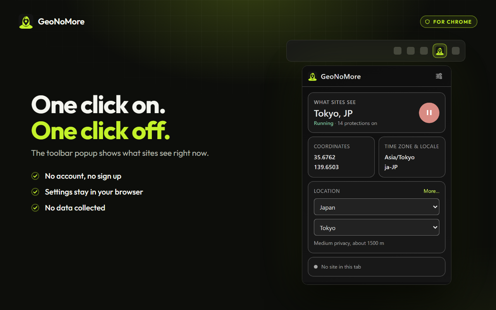

<div align="center">

<picture>
  <source media="(prefers-color-scheme: dark)" srcset="../../assets/logo-dark.svg">
  
</picture>

# GeoNoMore

**在 Chrome 和 Firefox 中伪造 GPS 位置，时区和语言同步跟随，不露任何破绽。**

[](../../LICENSE)
[](https://github.com/Miabeyefendi/GeoNoMore/releases/latest)
[](#)
[](#)
[](https://github.com/Miabeyefendi)

[English](../../README.md) · [Türkçe](../../docs/locales/README_TR.md) · [Español](../../docs/locales/README_ES.md) · **简体中文** · [Русский](../../docs/locales/README_RU.md)

[安装](#-安装) · [功能](#-亮点) · [使用](#-快速开始) · [更新日志](../../CHANGELOG.md)

<a href="https://github.com/Miabeyefendi/GeoNoMore/releases/latest">
  
</a>



</div>

---

## ✨ 亮点

- **伪造 GPS 位置** - 每个询问你位置的网站都会得到你选择的地点，包括 watchPosition 实时追踪
- **时区与语言同步** - Intl、Date、Temporal、navigator.language 和 Accept-Language 都与伪造地点一致
- **三种模式** - 固定点、隐私区域内的随机点，或自动步行、骑行、驾驶的路线
- **按网站设置规则** - 全部网站、仅列表内或列表外全部网站生效，也可以给单个网站设置独立位置
- **防泄露** - WebRTC 本地 IP、Web Worker、页面创建的框架，以及页面自己发起的 IP 查询
- **防追踪** - Global Privacy Control、清除链接中的追踪参数、关闭链接 ping 和 DNS 预解析
- **针对每个浏览器** - 在 Chrome 中关闭 Privacy Sandbox 广告追踪，在 Firefox 中所有窗口都启用追踪保护
- **IP 检测与完整日志** - 查看真实连接显示在哪里，以及交给网站的伪造位置
- **隐私优先的设计** - 无需账号，没有遥测，设置只保存在你的浏览器中

---

## 📦 安装

### 环境要求

| | |
|---|---|
| Chrome、Edge、Brave、Opera | 111 或更高版本 |
| Firefox | 140 或更高版本，Android 版 Firefox 142 或更高版本 |
| 从源码构建 | Node.js 18 或更高版本，无需安装其他依赖 |

### 技术栈


### 安装步骤

最简单的方式是使用浏览器的商店页面: [Chrome 应用商店](https://chromewebstore.google.com/detail/geonomore/idnfgjkaoakajojpoljeampjdakpncoe) · [Firefox 附加组件](https://addons.mozilla.org/firefox/addon/geonomore/)。自己构建:

```bash
git clone https://github.com/Miabeyefendi/GeoNoMore.git
cd GeoNoMore
node src/tools/build.js
```

<details>
<summary><b>改用发行版安装</b></summary>

1. 从 [发行版页面](https://github.com/Miabeyefendi/GeoNoMore/releases/latest) 下载对应浏览器的 zip。
2. Chrome、Edge、Brave 或 Opera: 解压 `geonomore-chromium-*.zip`，打开 `chrome://extensions`，开启开发者模式，选择"加载已解压的扩展程序"并选中解压后的文件夹。
3. Firefox: 打开 `about:debugging`，选择"此 Firefox"，再选择"临时载入附加组件"并选中 `geonomore-firefox-*.zip`。临时附加组件会在 Firefox 关闭后移除，商店版本不受影响。

每个发行版附带的文件，由本仓库通过 `node src/tools/build.js` 构建，纯 JavaScript，未压缩混淆:

| 文件 | 说明 | SHA-256 (5.1.2) |
|---|---|---|
| `geonomore-chromium-5.1.2.zip` | Chrome、Edge、Brave 和 Opera 安装包 | `292e0b970c0340010dd059df28d6ff1398645b7d003ef4fd519cabcaca60979d` |
| `geonomore-firefox-5.1.2.zip` | Firefox 与 Android 版 Firefox 安装包 | `e4c7ea38c872a51fa9d9671aa6aa6dcc3992a56cc57f4670b0584d607b21f9ec` |
| `geonomore-5.1.2-source.zip` | 供商店审核的源码包，见 [BUILD.md](../../docs/guides/BUILD.md) | `d843b96a0a5b130768cb1365c4409b24fe23f240552b389e9369addcc6409da7` |

</details>

<details>
<summary><b>浏览器扩展（Chrome 与 Firefox）</b></summary>

1. 构建两个安装包: `node src/tools/build.js`（只构建一个时在末尾加 `chromium` 或 `firefox`）。
2. 打开 `chrome://extensions`，Firefox 中打开 `about:debugging`。
3. 开启开发者模式，选择"加载已解压的扩展程序"并选中 `releases/extensions/chromium`；在 Firefox 中把 `releases/extensions/firefox/manifest.json` 作为临时附加组件载入。

</details>

---

## 🚀 快速开始

1. 点击工具栏中的 GeoNoMore 图标。
2. 选择一个国家和城市。
3. 按下播放按钮。

现在每个询问你位置的网站都会得到这个地点。设置页顶部的信息条准确显示网站所见的内容: 位置、时区和语言。再按一次按钮，真实位置就会恢复。

---

## 🖼️ 截图

<table>
<tr>
  <td align="center" width="50%">
    <br/>
    <sub><b>所有线索说法一致</b> · 时区、语言和 IP 查询都跟随你选择的地点</sub>
  </td>
  <td align="center" width="50%">
    <br/>
    <sub><b>停留或移动</b> · 地图上自动前进的路线</sub>
  </td>
</tr>
<tr>
  <td align="center" width="50%">
    <br/>
    <sub><b>为 Chrome 打造</b> · 防泄露、防指纹、防追踪，关闭 Privacy Sandbox</sub>
  </td>
  <td align="center" width="50%">
    <br/>
    <sub><b>一键开启，一键关闭</b> · 工具栏弹窗显示网站此刻看到的内容</sub>
  </td>
</tr>
</table>

---

## 📖 文档

- [**更新日志**](../../CHANGELOG.md) - 每个版本的变化（英文）
- [**构建说明**](../../docs/guides/BUILD.md) - 商店安装包的逐步构建方法（英文）
- [**隐私政策**](../../docs/store/privacy-policy.md) - 哪些数据留在你的设备上，以及两个可选请求（英文）
- [**参与贡献**](../../CONTRIBUTING.md) - 如何提交修改
- [**安全**](../../SECURITY.md) - 如何私下报告漏洞

---

## 🧭 路线图

- [ ] 同样保护 Shared Worker
- [ ] 首次安装时根据浏览器选择界面语言
- [ ] 在 Android 版 Firefox 真机上测试
- [x] 在 Chrome 和 Firefox 真实浏览器中做泄露审计 (5.1.0)

这里没有任何承诺。这是个人项目，列表会随我的优先级变化。

---

## ❓ 常见问题

<details>
<summary><b>它会改变我的 IP 地址吗？它是 VPN 吗？</b></summary>

不会。你的 IP 地址保持不变，任何浏览器扩展都无法改变它。通过你的 IP 在自己服务器上查询位置的网站仍会看到你的真实国家，这需要 VPN。GeoNoMore 改变的是浏览器自身报告的内容。

</details>

<details>
<summary><b>它会收集数据吗？</b></summary>

不会。没有账号，没有统计分析，也没有我的服务器。设置保存在你的浏览器中。扩展自身发出的网络请求包括：设置页面中的地图图片（来自你选择的瓦片服务器，默认 OpenStreetMap）、可选的地址搜索（OpenStreetMap）和可选的 IP 检测；后两者只在你按下对应按钮时运行。见 [隐私政策](../../docs/store/privacy-policy.md)。

</details>

<details>
<summary><b>更新之后就用不了了，怎么办？</b></summary>

先刷新页面，补丁只作用于开启之后打开的页面。然后查看"网站"选项卡，该网站可能被排除了。如果仍然不行，打开"历史"选项卡，复现问题，复制日志并 [提交 issue](https://github.com/Miabeyefendi/GeoNoMore/issues/new?template=bug_report.yml)。发送前请先阅读日志，它会列出你访问过的网站。

</details>

---

## 🤝 参与贡献

欢迎贡献。请先阅读 [CONTRIBUTING.md](../../CONTRIBUTING.md) 和
[CODE_OF_CONDUCT.md](../../CODE_OF_CONDUCT.md)。提交贡献即表示你同意以 GeoNoMore License
许可你的成果。

<div align="center">
<a href="https://github.com/Miabeyefendi/GeoNoMore/issues/new?template=bug_report.yml">
  <picture>
    <source media="(prefers-color-scheme: dark)" srcset="./assets/btn-report-bug-dark.svg">
    
  </picture>
</a>
<a href="https://github.com/Miabeyefendi/GeoNoMore/stargazers">
  <picture>
    <source media="(prefers-color-scheme: dark)" srcset="./assets/btn-star-dark.svg">
    
  </picture>
</a>
</div>

---

## 🛡️ 安全

发现漏洞了？不要公开提 issue。请按 [SECURITY.md](../../SECURITY.md) 中的私密流程
处理。

---

## 📜 许可证

本项目**源码公开，但不是开源软件**。完整条款见 [LICENSE](../../LICENSE)，补充条款见
[NOTICE](../../NOTICE)。简单说：

- 你可以阅读源码、审计它、在自己机器上修改，并把改动提交回来。欢迎贡献，源码公开正是为此。
- 你**不可以**发布、镜像、上架到任何商店，也不可以用它赚钱。GeoNoMore 由作者发布，
  其他人不得发布。
- 需要许可证不允许的事情，写信来问，联系方式在下面。

### 署名（强制）

根据许可证，以下署名必须在本项目的任何副本、复刻或部署中原样、
可见地保留：

> **Miabeyefendi (Mustafa Ihsan Albayrak)** - https://github.com/Miabeyefendi

### 免责声明

本软件按"原样"提供，不含任何形式的担保。你完全自担风险运行它，并对自己的使用
独自负责，包括遵守它所交互的任何第三方平台的服务条款。这些平台与作者没有关联，
也未为其背书；其名称和商标归各自所有者。在适用法律允许的最大范围内，作者对账号
封禁、数据丢失或任何其他损害不承担责任。完整条款见 [LICENSE](../../LICENSE) 与
[NOTICE](../../NOTICE) 文件。

---

## 📬 联系方式

- GitHub：[@miabeyefendi](https://github.com/Miabeyefendi)
- 商业授权或分成相关事宜，请通过我的 GitHub 主页联系我。

<div align="center">
<br/>

<br/>
<sub>由 <b><a href="https://github.com/Miabeyefendi">Miabeyefendi</a></b> 制作</sub>
</div>
